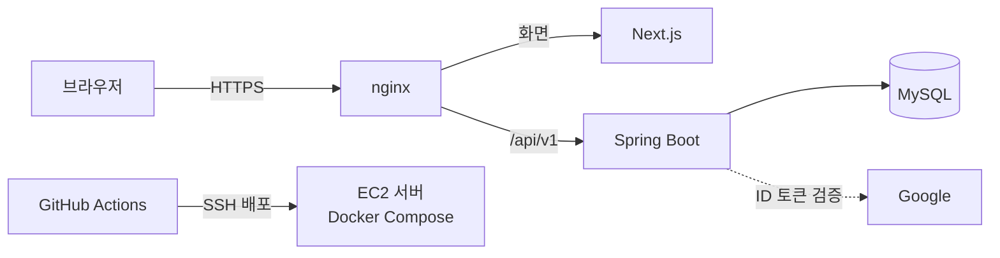
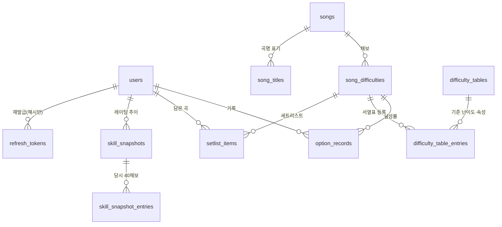

# SRPFreaks

GITADORA(Guitar / Bass) 플레이 기록을 **SRN+(SUPER RANDOM PLUS) 옵션으로** 저장하고, SRN+ 기준의 **레이팅 목록**(단일 15 + 그 외 25 = 40채보)과 플레이어 티어를 계산하는 **비공식 팬 웹 서비스**입니다.

- 서비스: https://srpfreaks.com
- 공식 서비스가 아니며 KONAMI와 관련이 없습니다. 서버는 KONAMI 계정·세션·쿠키를 받지도 저장하지도 않습니다.

## 주요 기능

| 영역 | 내용 |
|---|---|
| 기록 | 곡·채보별 달성률 직접 입력(한 손 입력 패드), 공식 사이트 최근 플레이 20곡 미리보기 후 저장, 풀콤보 표시 |
| 레이팅 | 단일 15 + 그 외 25 목록 계산, 플레이어 티어, 목표 레이팅 추산, 레이팅 스냅샷(추이) |
| 서열표 | 기준 난이도(0.1 단위)별 채보 묶음, 내 달성 현황(EXC / FC / SS / S / S 미만) |
| 곡 | 곡 목록·검색·상세, 관리자 곡·채보 관리 |
| 세트리스트 | 오늘 칠 채보 담기(최대 30곡), 내 레이팅 기준 추천, 기록 저장 시 완료 체크 |
| 커뮤니티 | 공지사항, 건의사항(곡 추가·개선·버그), 공개를 선택한 유저 목록 |
| 공통 | Google 로그인, 한국어·일본어, 다크·라이트 테마, 모바일 우선 화면 |

공지·곡 목록·서열표·유저 목록·설명서는 로그인 없이 읽을 수 있고, 기록 입력과 내 레이팅은 로그인이 필요합니다.

## 기술 스택

| 구분 | 사용 기술 |
|---|---|
| 백엔드 | Java 17, Spring Boot, Spring Web MVC, Spring Security + JJWT, Spring Validation, Spring Data JPA, MyBatis, Flyway, springdoc(Swagger), Lombok |
| 프론트엔드 | Next.js(App Router), React, TypeScript, TanStack Query, React Hook Form + Zod, Tailwind CSS, next-intl |
| DB | MySQL 8 (로컬은 Docker) |
| 테스트 | JUnit 5, Mockito, Testcontainers(MySQL) / Vitest, Testing Library |
| 배포 | Docker Compose, nginx, Let's Encrypt(certbot), GitHub Actions → AWS EC2 |

역할 분담: **JPA는 쓰기와 단순 조회**, **MyBatis는 복잡한 읽기 전용 쿼리**(집계, 레이팅 계산)만 맡습니다. MyBatis로는 쓰기를 하지 않습니다.

## 아키텍처



- nginx가 화면(Next.js)과 API(Spring Boot)를 한 도메인에서 나눠 받습니다.
- 로그인은 Google만 씁니다. 비밀번호를 저장하지 않습니다.
- 배포는 GitHub Actions 화면에서 직접 실행했을 때만 돌고(푸시로는 실행되지 않음), 배포 뒤 점검이 실패하면 워크플로가 실패로 표시됩니다.

### 백엔드 패키지

`com.srpfreaks.backend.{config, controller, service, repository, mapper, entity, dto, security, common}` 계층형 구조입니다. 엔티티를 API에 직접 쓰지 않고 DTO를 거칩니다.

## 데이터 모델

스키마의 기준은 Flyway 마이그레이션(`backend/src/main/resources/db/migration`)이고, `ddl-auto: validate`로 엔티티와 어긋나면 시작 때 막습니다. 핵심 테이블만 그리면 다음과 같습니다.



- 기록(`option_records`)은 `note_option` 컬럼으로 옵션을 구분하며, 현재는 `SUPER_RANDOM_PLUS` 하나만 받습니다.
- 달성률은 `DECIMAL(5,2)`(0.00~100.00)이고 프론트(Zod) / 백엔드(Validation) / DB(CHECK) 세 곳에서 검증합니다.
- 삭제는 소프트 삭제(`is_deleted`)이고, 시간은 UTC로 저장해 화면에서 Asia/Seoul로 바꿉니다.
- 레이팅 값과 플레이어 티어는 **저장하지 않고 계산**합니다. 예외는 사용자가 누른 시점의 추이 사본인 스냅샷뿐입니다. 티어 구간표(`player_tiers`)는 사용자와 연결되지 않은 설정 테이블이라 그림에서 뺐습니다.

## 레이팅 계산

서열표의 기준 난이도(T)에서 **레이팅 상수 R**을 구하고, 달성률(A)로 채보 값 V를 계산합니다. 화면 점수는 V × 20입니다.

```
R = 5×T − 15          (T > 6.0)
R = 10×T − 45         (T ≤ 6.0)
V = R × min(A, 80)/100 + 3.2 × min(max(A − 80, 0), 15)/15
점수 = V × 20
```

80%까지는 선형으로 오르고, 80~95%에서 최대 +3.2가 더해지며, 95% 이상은 더 오르지 않습니다. 레벨은 계산에 쓰지 않습니다.

| 기준 난이도 T | 상수 R | 달성률 A | 채보 값 V | 점수 |
|---|---|---|---|---|
| 7.0 | 20 | 95 | 19.20 | 384.00 |
| 7.0 | 20 | 100 | 19.20 | 384.00 |
| 6.5 | 17.5 | 90 | 16.13 | 322.67 |
| 6.0 | 15 | 80 | 12.00 | 240.00 |
| 5.0 | 5 | 90 | 6.13 | 122.67 |
| 5.0 | 5 | 0 | 0.00 | 0.00 |

**목록 구성**: 속성이 단일인 채보 상위 15개 + 그 외(복합·이중·삼중) 상위 25개, 합계 40채보입니다. 곡당 1채보로 거르지 않으며(같은 곡의 다른 채보도 각각 셉니다) Guitar와 Bass는 한 목록입니다. 기준 난이도나 속성이 없는 채보는 계산에서 빠지고 기록만 남습니다.

**플레이어 티어**: 40채보의 점수 합계(정수부) 구간으로 White부터 HSB까지 22단계에서 찾습니다. 구간은 `player_tiers` 테이블에 있어 코드를 고치지 않고 바꿀 수 있습니다.

계수(80, 95, 3.2, 20, 기준점 6.0)와 목록 개수는 `app_settings`의 `rating.*` 설정이고, 수식의 모양은 코드에 있습니다. 자세한 규칙과 동점 처리는 [`docs/DESIGN.md`](docs/DESIGN.md) 7장에 있습니다.

## 설계 결정

결정은 번호(D1~)로 [`docs/DESIGN.md`](docs/DESIGN.md)에 날짜와 이유를 남기고, 바뀌면 지우지 않고 새 번호로 덧붙입니다. 대표적인 것만 옮깁니다.

| 번호 | 결정 |
|---|---|
| D3 | 스킬 값은 저장하지 않고 계산한다 (이후 D32에서 사용자가 누른 시점의 스냅샷만 좁게 허용) |
| D6 | JPA(쓰기·단순 조회) + MyBatis(복잡한 읽기), 배포는 로컬 검증 후 GitHub Actions → EC2 |
| D18 | 스킬 계산을 상수표 방식으로 확정, 공식 사이트 가져오기는 보류 |
| D19 | 로그인은 Google만 사용, 비밀번호를 저장하지 않는다 |
| D20 | access 토큰 15분, 탈퇴는 사용자와 기록을 완전히 삭제 |
| D23 | CSV 일괄 입력·내려받기를 만들지 않는다 (기록은 한 건씩 직접 입력) |
| D25 | 기록은 SRN+ 하나만 받는다 (옵션 enum은 확장 대비로 유지) |
| D34·D40 | 공식 사이트 최근 플레이는 서버가 접속하지 않고, 사용자 브라우저가 읽은 한 화면을 미리보기 후 저장 |
| D41 | 한국어·일본어 지원(주소는 바꾸지 않고 쿠키로 언어 선택) |
| D43 | 공지·곡·서열표·유저 목록·설명서는 로그인 없이 GET만 공개, IP 기준 요청 제한 |

## 보안

- 기본 정책은 deny all이고 공개 경로만 명시적으로 허용합니다. 비로그인 공개는 GET 읽기 경로 목록(`PublicReadPaths`)에만 열려 있습니다.
- Access 토큰과 Refresh 토큰을 종류(`typ`)로 구분하고, API 인증에는 Access 토큰만 받습니다.
- Refresh 토큰은 httpOnly + Secure + SameSite=Strict 쿠키로 보내고, DB에는 해시만 저장하며 Rotation과 재사용 탐지를 적용합니다. Access 토큰은 메모리에만 둡니다.
- 권한은 ROOT > ADMIN > USER 계층이고, `@PreAuthorize`와 서비스 계층의 소유자 검증을 함께 씁니다. 타인의 기록에 접근하면 404로 응답해 존재 여부를 숨깁니다.
- 로그인·재발급·공개 읽기에는 요청 제한을 두고, 관리자 작업은 감사 로그(`audit_logs`)에 남깁니다.
- MyBatis는 `#{}`만 쓰고 `${}`는 쓰지 않으며, 정렬·필터 값은 화이트리스트로 검증합니다.
- 비밀값(DB 비밀번호, JWT 키, 클라이언트 ID 등)은 코드에 넣지 않고 환경변수로만 받습니다.

## 테스트

- 백엔드: 서비스는 JUnit 5 + Mockito, 쿼리는 Testcontainers MySQL로 실제 DB에서 검증합니다(집계·레이팅 계산 쿼리 필수). 레이팅 계산은 직접 계산한 예시값(달성률 0/80/95/100, 기준 난이도 6.0 전후), 단일/그 외 그룹 분리, 목록이 모자랄 때, 기준 난이도·속성 없는 채보 제외를 확인합니다.
- 보안: 권한별 접근(USER가 ROOT API → 403), 타인 기록 접근, Refresh 토큰으로 API 호출 시 거부.
- 프론트엔드: Vitest + Testing Library로 화면과 입력 규칙(달성률 경계값 포함)을 검사합니다.
- CI(GitHub Actions)가 프론트 검사·빌드, 프론트 테스트, 백엔드 테스트, 배포 스크립트 테스트를 PR마다 돌립니다.

## 로컬 실행

```bash
# 1. DB (루트에서) — .env.example을 .env로 복사해 비밀번호를 채웁니다
docker compose up -d

# 2. 백엔드 (backend 폴더에서)
./gradlew bootRun        # Windows: gradlew.bat bootRun
./gradlew test

# 3. 프론트엔드 (frontend 폴더에서)
npm install
npm run dev
npm run lint && npm run typecheck && npm test
```

백엔드에 필요한 환경변수 목록은 `.env.example`을 참고하세요. 값은 저장소에 두지 않습니다. DB를 초기화하려면 `docker compose down -v`를 씁니다.

## 폴더 구조

```
backend/    Spring Boot (계층형 패키지, Flyway 마이그레이션)
frontend/   Next.js (App Router)
nginx/      운영 리버스 프록시 설정
scripts/    배포·시드 보조 스크립트
docs/       설계 문서
```

| 문서 | 내용 |
|---|---|
| [`docs/DESIGN.md`](docs/DESIGN.md) | 데이터, API, 보안, 계산 규칙, 결정 기록(D1~) |
| [`docs/DESIGN-UI.md`](docs/DESIGN-UI.md) | 화면, 색, 표시 규칙, 변경 이력 |
| [`docs/I18N-GLOSSARY.md`](docs/I18N-GLOSSARY.md) | 일본어 번역 용어집 |
| [`docs/DEPLOY-PLAN.md`](docs/DEPLOY-PLAN.md) | 배포 계획 |
| [`CLAUDE.md`](CLAUDE.md) | AI와 작업할 때의 규칙 |

## 출처

- 서열표(기준 난이도) 정보 제공·설계: イズニャン ([@trist_is](https://x.com/trist_is))
- 레이팅 수식은 스프레드시트 제작자가 만든 지표이며 사용 허락을 받았습니다.

## 라이선스

[MIT License](LICENSE)
